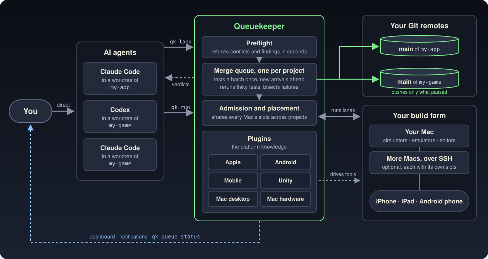
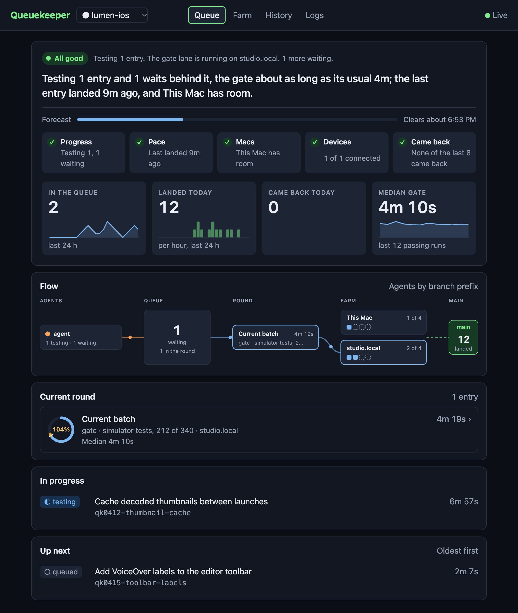

<p align="center">
  
</p>

Queuekeeper is a merge queue and build farm for one developer working with AI coding agents. It
runs on that developer's own machines instead of in the cloud. Agents hand it commits; it batches
them, tests each batch once on whichever machine has room, and pushes to `main` only what passed.

Its Apple, Unity, Mac desktop and Mac hardware [plugins](#plugins) handle the local tools and
hardware that builds and tests depend on.

## Why another merge queue?

Merge queues serve different workflows. Queuekeeper brings one developer's agents, projects and
local machines together, with a few priorities:

- **Designed for AI agents.** One developer can direct several agents across several projects.
  Commands run without prompts and return verdicts, failure details and next steps that agents can
  act on. Agents submit commits and follow their results, while Queuekeeper coordinates shared
  build capacity and tests batches before they reach `main`.
- **Builds that need local tools.** Cloud queues and build farms suit web services and large teams.
  They suit mobile apps, video games and other front-end work less well, because those need tools
  such as Xcode, Unity or Unreal, along with simulators and real devices, which are difficult or
  expensive to run in the cloud.
- **Platform knowledge.** Building and testing for iOS, Android or a game engine unattended takes
  specialized knowledge: managing simulators, sharing a device between runs, driving interactive
  tests, and telling a broken machine from a broken commit. That knowledge belongs in the tool, and
  it is what the plugins are for.
- **Hardware you already own.** The build farm is the machine on your desk plus any others you can
  reach. Nothing has to be rented.

[Related tools](doc/related_tools.md) compares Queuekeeper feature by feature with other merge
queues, including other local queues for AI agents, and says where they are the better choice.

<p align="center">
  
</p>

## Getting started

Suppose you use Claude Code or Codex to work on two projects already checked out at
`~/Development/my-app` and `~/Development/my-game`. You want agents in both repositories to send
finished work through Queuekeeper and share your Mac's build capacity. Set up Queuekeeper once on
the Mac, then configure each repository. You can ask an agent to do the setup with the prompts below;
replace the example paths with yours. Using agents is optional: you can also set up and use
Queuekeeper directly from the command line. The [setup guide](doc/getting_started.md) has the
commands and configuration details.

**1. Check that the projects fit.** You need macOS, Python 3.14 or newer, Git, and the tools that
already build and test each project. Each repository needs a remote named `origin` that can be
pushed to without a prompt, and must allow changes to land directly on `main`. Queuekeeper does
not integrate through pull requests. Start with one Mac; you can [add more](doc/getting_started.md#add-a-second-mac)
if needed to speed up builds and tests.

**2. Install Queuekeeper once.** In an agent session with access to your development folder, ask:

> Clone https://github.com/vocaro/queuekeeper.git into ~/Development/queuekeeper. Read
> doc/getting_started.md, check the requirements, and install it with
> `python3 tools/install-checkout.py` using Python 3.14 or newer. Make sure `qk --help` works
> in the shell my agents use. Report any missing tools or setup I need to handle.

Keep that checkout: the installed `qk` command runs it. Both projects use the same installation.
The [installation guide](doc/getting_started.md#install) explains the PATH setup and how to update
or remove it.

**3. Configure each project.** Open an agent session in each repository and give it this task:

> Set up this repository for Queuekeeper using ~/Development/queuekeeper/doc/getting_started.md.
> Inspect the existing build and test scripts, then add queuekeeper.json with a gate that runs
> this project's checks and has an explicit timeout. Enable the plugins this project needs;
> read their setup docs first. Check the default spelling and documentation-only behavior with
> me. Run `qk doctor` and resolve its findings. Work on a branch and leave the setup ready to review.

Each repository gets its own `queuekeeper.json`, gate and queue. The projects can use different
test commands and plugins while sharing the Mac's capacity. For an Apple app, start with the
[Apple plugin](src/python/queuekeeper/apple/README.md); for a Unity project, use the
[Unity plugin](src/python/queuekeeper/unity/README.md). The [Mac desktop and hardware plugins](#plugins)
cover unattended desktop sessions and tests that depend on a particular chip.

**4. Teach future agent sessions the workflow.** In both repositories, have the agent update the
project instructions that your coding tools read, such as `CLAUDE.md` or `AGENTS.md`. Ask it to
include the [agent instructions from the setup guide](doc/getting_started.md#tell-your-agents),
adapting the lane names to the project. Those instructions tell agents to:

- Submit committed work with `qk land --wait` instead of pushing to `main`, and follow it to a result.
- Run builds and tests through `qk run LANE` or `qk admit -- COMMAND` so agents in both projects
  share the machine without overloading it.
- Fix failures using the verdict and logs, and resume following an existing queue entry if a wait
  is interrupted.

This is what makes Queuekeeper part of everyday agent work. Installing the command alone does
not change how an agent builds, tests or pushes.

**5. Review and land the setup in both repositories.** Review each project's gate, plugin settings
and agent instructions, then ask its agent to commit and land the setup through Queuekeeper.
The first landing runs the gate defined by the setup commit; later landings use the settings on
`main`, so a branch cannot loosen its own checks. Queuekeeper tests in a checkout of its own and
pushes what passes, leaving the agent's working tree alone.

Ask each agent to confirm that its setup landed on `origin/main` and report the queue result.
If a gate fails, have it fix the cause and submit the correction. Once both setups have landed,
new agent sessions in either project can use the same workflow for their changes.

**6. Choose how to follow the work.** Ask an agent to enable the [dashboard](#dashboard) for a view
across projects, or [notifications](doc/visibility.md) when the queue needs your attention. Agents
can check their own project's queue with `qk queue status`.

Run `qk disk` for a read-only inventory of Queuekeeper-managed build caches, test results and
simulator resources, including safe cleanup candidates; see
[Reclaiming disk space](guides/shared-host.md#reclaiming-disk-space).

## Dashboard

The dashboard is a web page of the queue and the build farm, served from your own Mac. It shows
every project whose queue has run since the dashboard was turned on, and redraws itself as the queue
changes.

```sh
qk visibility enable dashboard
qk serve --open
```

**Home** (the Queue tab) shows the day's summary, the current test round, entries in progress, and
entries up next. New arrivals tested on top of the current batch are labeled **Testing ahead**.

<p align="center">
  
</p>

**Farm** shows each Mac's slots, its load, and the work running and waiting on it, for every
project. It also shows iOS device connections and reservations.

<p align="center">
  
</p>

**History** holds recent changes and events; **Logs** holds debug output. See
[Visibility](doc/visibility.md#the-dashboard-feature) for details.

## Plugins

A plugin teaches Queuekeeper a platform. A project switches one on by listing it in the
`extensions` of its `queuekeeper.json`.

### Apple plugin

The [Apple plugin](src/python/queuekeeper/apple/README.md) lets agents build and test iOS and Mac
apps without getting in each other's way:

- **Simulator pool.** Each run gets its own simulator, reset from a warmed template in a fraction of
  a second.
- **Test runners.** One build tested on several device types at once, with tests spread across
  simulators.
- **Physical devices.** Agents take an iPhone or iPad in turn, and a run is stopped before its
  reservation ends.

### Unity plugin

The [Unity plugin](src/python/queuekeeper/unity/README.md) runs a Unity project's editor
unattended. It picks the editor the project pins, clears a project lock nothing holds, ends a batch
run that has gone silent, and runs the project's tests.

### Mac desktop plugin

The [Mac desktop plugin](src/python/queuekeeper/mac_desktop/README.md) handles a Mac's logged-in
session when nobody is at it. Crash dialogs, notification banners, locked keychains and lapsed
permissions are cleared, or the run is reported as unmeasured instead of failed. The Apple and
Unity plugins build on it.

### Mac hardware plugin

The [Mac hardware plugin](src/python/queuekeeper/mac_hardware/README.md) keeps a lane on the chip
its results are valid on. A lane whose output differs by GPU lists its chips, such as
`"chips": ["apple-m5-max"]`, and runs only on a Mac that has one.

## Documentation

- [Getting started](doc/getting_started.md)
- [The merge queue](doc/merge_queue.md): landing, batching, flakes, bisecting, holds
- [Lanes and admission](doc/lanes_and_admission.md): what a lane is, and how a machine decides it
  has room
- [The build farm](doc/build_farm.md): running lanes on other Macs
- [The agent interface](doc/agent_interface.md): exit codes and output that agents act on
- [Visibility](doc/visibility.md): the terminal view, notifications, the web dashboard and the
  event journal under them
- [Related tools](doc/related_tools.md)

The guides hold the detail, with the measurements and decisions behind each rule:

- [Maintenance](guides/maintenance.md): operating the merge queue, and the spelling check
- [Shared host](guides/shared-host.md): admission, the second Mac, disk cleanup, device reservations
  and process supervision
- [Lanes](guides/lanes.md): receipts, how tests are counted, compiling first, tests no lane runs,
  the gate's time budget
- [Parallel tests](guides/parallel-tests.md): lane groups, `qk unittest`, `qk simulator-tests` and
  `qk xctest`
- [Simulator pool](guides/simulator-pool.md), [physical devices](guides/devices.md) and
  [kept app builds](guides/app-builds.md), for the Apple plugin
- [Foreground runs](guides/foreground.md): taking a Mac's screen for a lane
- [Cloud gate runners](guides/cloud-gate-runners.md): renting a Mac for the queue

## License

Copyright 2026 Vocaro Technologies LLC

[Apache License 2.0](LICENSE).
