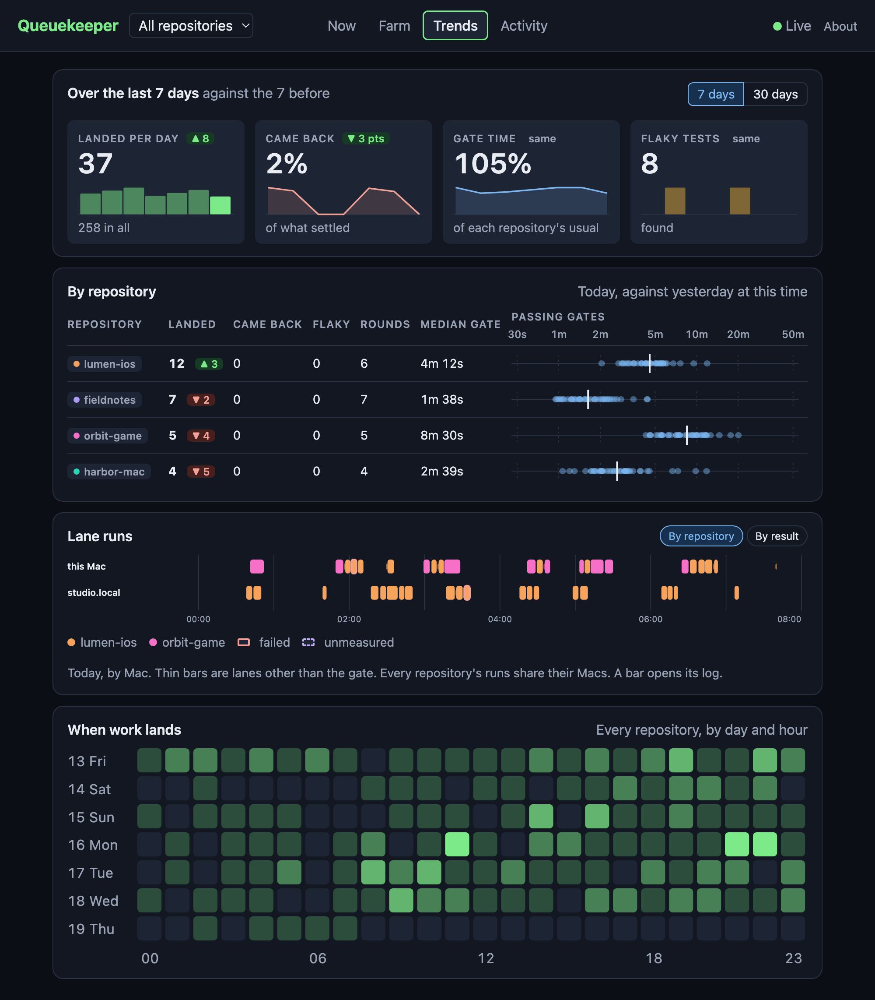
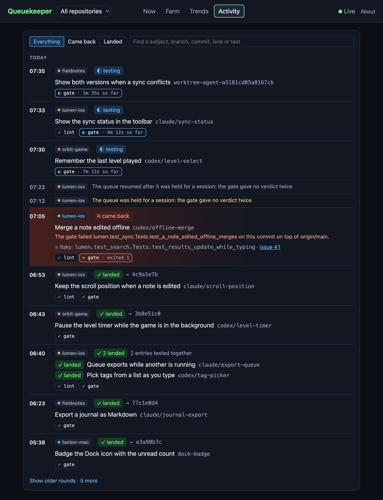

<p align="center">
  
</p>

Queuekeeper is a merge queue and build farm for one developer working with AI coding agents. It
runs on that developer's own machines instead of in the cloud. Agents hand it commits; it batches
them, tests each batch once on whichever machine has room, and pushes to `main` only what passed.
Its [plugins](#plugins) handle the local tools and hardware that builds and tests depend on.

## Why another merge queue?

Merge queues serve different workflows. Queuekeeper brings one developer's agents, projects and
local machines together, with a few priorities:

- **Designed for AI agents.** One developer can direct several agents across several projects.
  Commands run without prompts and return verdicts, failure details and next steps that agents can
  act on. Agents submit commits and follow their results, while Queuekeeper coordinates shared
  build capacity and tests batches before they reach `main`.
- **Builds that need local tools.** Cloud queues and build farms suit web services and large teams.
  They suit mobile apps, video games and other front-end work less well, because those need tools
  such as Xcode, Unity or Unreal, along with simulators and real devices, which are difficult or
  expensive to run in the cloud.
- **Platform knowledge.** Building and testing for iOS, Android or a game engine unattended takes
  specialized knowledge: managing simulators, sharing a device between runs, driving interactive
  tests, and telling a broken machine from a broken commit. That knowledge belongs in the tool, and
  it is what the plugins are for.
- **Hardware you already own.** The build farm is the machine on your desk plus any others you can
  reach. Nothing has to be rented.

[Related tools](doc/related_tools.md) compares Queuekeeper feature by feature with other merge
queues, including other local queues for AI agents, and says where they are the better choice.

<p align="center">
  
</p>

## Getting started

Queuekeeper needs macOS, Python 3.14 or newer and Git. Each project needs an `origin` remote it can
push to without a prompt and must allow changes to land directly on `main`; Queuekeeper does not
integrate through pull requests. Start with one Mac and [add more](doc/user_guide.md#add-another-mac)
later if builds need it. You can do each step below yourself, following the
[user guide](doc/user_guide.md#set-up), or ask an agent to do it.

1. **Install once per Mac.** Clone this repository into `~/Development/queuekeeper` and run
   `python3 tools/install-checkout.py`. Keep the checkout: the installed `qk` command runs from it
   ([details](doc/user_guide.md#install)).
2. **Configure each project.** Add a `queuekeeper.json` whose gate runs the project's checks, enable
   the [plugins](#plugins) it needs, and resolve what `qk doctor` reports. Each project keeps its own
   gate and queue while sharing the Mac's capacity.
3. **Teach your agents.** Run `qk agents setup --guard` in each project. It writes the
   [agent instructions](doc/user_guide.md#tell-your-agents) into `AGENTS.md` or `CLAUDE.md`, so agents
   land work with `qk land --wait` instead of pushing to `main` and run builds and tests through
   `qk run` or `qk admit`, and adds Claude Code hooks that report entries that came back when a
   session starts and refuse pushes to `main`. Installing `qk` alone does not change how agents work.
4. **Land the setup.** Commit the configuration and agent instructions on a branch, then run
   `qk land --wait` and follow it to its result. The first landing uses the checks in the setup
   commit and creates `main` if the remote has none. Later landings use `main`'s queue policy
   ([details](doc/user_guide.md#a-projects-first-landing)).
5. **Follow the work** in the [dashboard](#dashboard), through
   [notifications](doc/user_guide.md#the-notify-feature), or with `qk queue status`.

## Project configuration

`queuekeeper.json` is a project’s Queuekeeper configuration file. It lives at the root of a
repository and defines the project’s plugins, named checks called *lanes*, and the lanes the merge
queue runs.

In this iOS example, `queue.preflight` runs a quick lint check before an entry joins the queue.
`queue.lanes` names the two checks a batch must pass before landing a code change. The `gate` lane
runs unit tests, and `ui-smoke` runs a small set of UI tests for critical flows on an iPhone
simulator. Each lane’s timeout is in seconds.

```json queuekeeper.json
{
  "schemaVersion": 1,
  "name": "MyApp",
  "plugins": ["queuekeeper_apple"],
  "lanes": {
    "lint": {
      "command": ["scripts/lint.sh"],
      "timeout": 30
    },
    "gate": {
      "command": [
        "xcodebuild", "test",
        "-project", "MyApp.xcodeproj",
        "-scheme", "MyApp",
        "-destination", "platform=iOS Simulator,name=iPhone 17 Pro",
        "-only-testing:MyAppTests"
      ],
      "timeout": 1800
    },
    "ui-smoke": {
      "command": [
        "xcodebuild", "test",
        "-project", "MyApp.xcodeproj",
        "-scheme", "MyApp",
        "-destination", "platform=iOS Simulator,name=iPhone 17 Pro",
        "-only-testing:MyAppUITests/SmokeTests"
      ],
      "timeout": 900
    }
  },
  "queue": {
    "preflight": ["lint"],
    "lanes": ["gate", "ui-smoke"]
  }
}
```

An agent can set up `queuekeeper.json` for you using the build and test commands your project
already runs.

For more details, see the [project configuration guide](doc/user_guide.md#configure-a-project).

## Dashboard

The dashboard is a web page of the queue and the build farm, served from your own Mac. It shows
every project whose queue has run since the dashboard was turned on, all at once, and redraws itself
as the queues change. The picker in its header narrows any tab to one project.

```sh
qk visibility enable dashboard
qk serve --open
```

**Now** shows one verdict on every queue, naming any project that needs a look, the day's totals,
a row for each project, every round being tested, and every entry in progress and up next. New
arrivals tested on top of the current batch are labeled **Testing ahead**. Its **Flow** map follows
each entry from the agent that queued it, Claude, Codex or a person, through its project's queue and
the round's gates to the Macs they run on and to main.

<p align="center">
  
</p>

**Farm** shows each Mac's slots, its load, and the work running and waiting on it, for every
project. It also shows phone and tablet connections and reservations.

<p align="center">
  
</p>

**Trends** sets the last 7 or 30 days against the ones before: landings per day, how often entries
came back, gate times against each project's usual, and flaky tests. It also shows each project's
day so far, today's lane runs on each Mac, when work lands by day and hour, and each lane's timing
baseline against its recent passing runs.

<p align="center">
  
</p>

**Activity** lists each round, newest first, with how each entry ended and a link to every lane's
log, which opens in **Logs** with its failures marked.

<p align="center">
  
</p>

See [the user guide](doc/user_guide.md#the-dashboard) for details.

## Plugins

A plugin teaches Queuekeeper a platform. A project switches one on by listing its package in the
`plugins` of its `queuekeeper.json`, such as `"plugins": ["queuekeeper_apple"]`. Omitting that
key loads the core alone.

- **[Apple](plugins/apple/src/queuekeeper_apple/README.md)** lets agents build and test iOS and Mac
  apps without getting in each other's way. Each run gets its own simulator, reset from a warmed
  template in a fraction of a second; one build is tested on several device types at once; and agents
  take an iPhone or iPad in turn, with a run stopped before its reservation ends.
- **[Android](plugins/android/src/queuekeeper_android/README.md)** does the same for Android apps.
  Each run gets its own emulator, cloned from a warmed template, and one Gradle build's instrumented
  tests run on several emulators at once. Agents take an Android phone in turn, with Do Not Disturb
  set and confirmed over adb.
- **[Mobile](plugins/mobile/src/queuekeeper_mobile/README.md)** is what the Apple and Android plugins
  share: the record that reserves phones and tablets, bounded runs on them, the device pass, and which
  Mac reaches each device. Listing either platform brings it.
- **[Unity](plugins/unity/src/queuekeeper_unity/README.md)** runs a Unity project's editor unattended.
  It picks the editor the project pins, clears a project lock nothing holds, ends a batch run that has
  gone silent, and runs the project's tests.
- **[Mac desktop](plugins/mac-desktop/src/queuekeeper_mac_desktop/README.md)** handles a Mac's
  logged-in session when nobody is at it. Crash dialogs, notification banners, locked keychains and
  lapsed permissions are cleared, or the run is reported as unmeasured instead of failed. The mobile
  and Unity plugins build on it.

## Documentation

- **[User guide](doc/user_guide.md)**: setting up, landing changes, lanes and admission, the build
  farm, the agent interface, notifications and the dashboard, and troubleshooting.
- **[Developer guide](doc/developer_guide.md)**: how Queuekeeper works inside, the goals behind its
  scheduling, writing a visibility feature, and an index of the detailed reference guides.
- **[Related tools](doc/related_tools.md)**: how Queuekeeper compares with other merge queues.
- **[Contributing](CONTRIBUTING.md)** and **[security](SECURITY.md)**: reporting problems and
  sending changes.

## License

Copyright 2026 Vocaro Technologies LLC

[Apache License 2.0](LICENSE).
