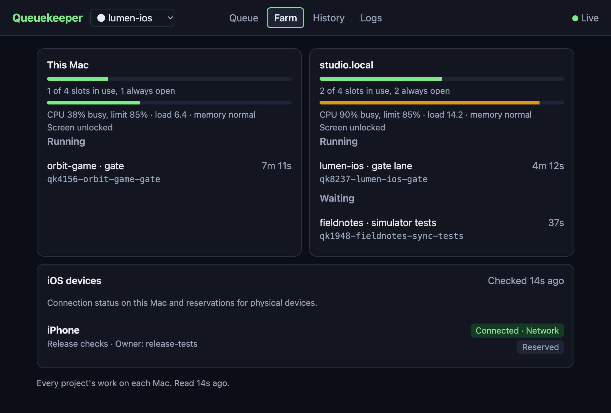

<p align="center">
  
</p>

Queuekeeper is a merge queue and build farm for one developer working with AI coding agents. It
runs on that developer's own machines instead of in the cloud. Agents hand it commits; it batches
them, tests each batch once on whichever machine has room, and pushes to `main` only what passed.

What sets it apart is its plugins, which know how to build and test software that needs local tools
and real hardware. The Apple plugin manages simulators, physical devices and Xcode test runs. The
Unity plugin runs a Unity editor unattended.

## Why another merge queue?

Several good merge queues exist, and for most teams one of them is the right choice. Queuekeeper
was built for a case they fit poorly:

- **Builds that need local tools.** Cloud queues and build farms suit web services and large teams.
  They suit mobile apps, video games and other front-end work less well, because those need tools
  such as Xcode, Unity or Unreal, along with simulators and real devices, which are difficult or
  expensive to run in the cloud.
- **Platform knowledge.** Building and testing for iOS, Android or a game engine unattended takes
  specialized knowledge: managing simulators, sharing a device between runs, driving interactive
  tests, and telling a broken machine from a broken commit. That knowledge belongs in the tool, and
  it is what the plugins are for.
- **Hardware you already own.** The build farm is the machine on your desk plus any others you can
  reach. Nothing has to be rented.

[Related tools](doc/related_tools.md) compares Queuekeeper feature by feature with other merge
queues, including other local queues for AI agents, and says where they are the better choice.

<p align="center">
  
</p>

## Getting started

This walk-through adds Queuekeeper to an existing project and lands a first change through it. An AI
agent can do every step for you, so you need not touch the command line: ask one to set the project
up. The commands are here for when you want to run them yourself. It assumes Queuekeeper is
installed: [Getting started](doc/getting_started.md) covers the requirements and installation.

**1. Say how the project is tested.** Create `queuekeeper.json` at the root of the repository. It
needs one lane named `gate`, which is the command every change must pass:

```json
{
  "schemaVersion": 1,
  "name": "my-project",
  "extensions": [],
  "lanes": {
    "gate": {"command": ["scripts/test.sh"], "timeout": 1800}
  }
}
```

Use your project's name for `name`. The empty `extensions` list starts with the core alone; add
a [plugin](#plugins) when the project needs one.

**2. Check the setup.** `qk doctor` reports anything missing, such as a lane with no timeout.

```sh
qk doctor
```

**3. Land a change.** Commit on a branch, then queue the commit instead of pushing it:

```sh
git switch -c add-queuekeeper
git add queuekeeper.json
git commit -m "Add Queuekeeper"
qk land --wait
```

Queuekeeper applies your commit on top of the latest `main` in a checkout of its own, runs the gate
there, and pushes if the gate passes. Your working tree is not touched. `--wait` follows the commit
to its result.

The queue reads its lanes from `main`, which has none until this commit is there, so for this one
landing it runs the gate the commit brings
([A project's first landing](guides/maintenance.md#a-projects-first-landing)).

**4. Watch the queue.** `qk queue status` shows what is waiting, what is being tested and why
anything is held. Three features show more, each turned on with `qk visibility enable`:

- **Watch.** `qk watch` shows the queue in the terminal and redraws it as it changes.
- **Notify.** A macOS banner, a command of yours or a webhook tells you when the queue needs you: a
  hold only you can fix, a change that came back, a flaky test, a landing that skipped the gate.
- **Dashboard.** `qk serve` serves a [web page of the queue](#dashboard) and the build farm.

See [Visibility](doc/visibility.md) for details.

**5. If the change comes back.** When the gate fails or the commit conflicts with `main`,
`qk land --wait` exits with status 1 and says why, with the path of the log. Nothing was
pushed. Fix the problem, commit, and run `qk land --wait` again.

From here, [add a second Mac](doc/getting_started.md#add-a-second-mac) so gates run off your
desk, and turn on a [plugin](#plugins) for your platform.

## Dashboard

The dashboard is a web page of the queue and the build farm, served from your own Mac. It shows
every project whose queue has run since the dashboard was turned on, and redraws itself as the queue
changes.

```sh
qk visibility enable dashboard
qk serve --open
```

**Home** (the Queue tab) shows the day's summary, the current test round, entries in progress, and
entries up next. New arrivals tested on top of the current batch are labeled **Testing ahead**.

<p align="center">
  
</p>

**Farm** shows each Mac's slots, its load, and the work running and waiting on it, for every
project. It also shows iOS device connections and reservations.

<p align="center">
  
</p>

**History** holds recent changes and events; **Logs** holds debug output. See
[Visibility](doc/visibility.md#the-dashboard-feature) for details.

## Plugins

A plugin teaches Queuekeeper a platform. A project switches one on by listing it in the
`extensions` of its `queuekeeper.json`.

### Apple plugin

The [Apple plugin](src/python/queuekeeper/apple/README.md) lets agents build and test iOS and Mac
apps without getting in each other's way:

- **Simulator pool.** Each run gets its own simulator, reset from a warmed template in a fraction of
  a second.
- **Test runners.** One build tested on several device types at once, with tests spread across
  simulators.
- **Physical devices.** Agents take an iPhone or iPad in turn, and a run is stopped before its
  reservation ends.

### Unity plugin

The [Unity plugin](src/python/queuekeeper/unity/README.md) runs a Unity project's editor
unattended. It picks the editor the project pins, clears a project lock nothing holds, ends a batch
run that has gone silent, and runs the project's tests.

### Mac desktop plugin

The [Mac desktop plugin](src/python/queuekeeper/mac_desktop/README.md) handles a Mac's logged-in
session when nobody is at it. Crash dialogs, notification banners, locked keychains and lapsed
permissions are cleared, or the run is reported as unmeasured instead of failed. The Apple and
Unity plugins build on it.

### Mac hardware plugin

The [Mac hardware plugin](src/python/queuekeeper/mac_hardware/README.md) keeps a lane on the chip
its results are valid on. A lane whose output differs by GPU lists its chips, such as
`"chips": ["apple-m5-max"]`, and runs only on a Mac that has one.

## Documentation

- [Getting started](doc/getting_started.md)
- [The merge queue](doc/merge_queue.md): landing, batching, flakes, bisecting, holds
- [Lanes and admission](doc/lanes_and_admission.md): what a lane is, and how a machine decides it
  has room
- [The build farm](doc/build_farm.md): running lanes on other Macs
- [The agent interface](doc/agent_interface.md): exit codes and output that agents act on
- [Visibility](doc/visibility.md): the terminal view, notifications, the web dashboard and the
  event journal under them
- [Related tools](doc/related_tools.md)

The guides hold the detail, with the measurements and decisions behind each rule:

- [Maintenance](guides/maintenance.md): operating the merge queue, and the spelling check
- [Shared host](guides/shared-host.md): admission, the second Mac, disk cleanup, device reservations
  and process supervision
- [Lanes](guides/lanes.md): receipts, how tests are counted, compiling first, tests no lane runs,
  the gate's time budget
- [Parallel tests](guides/parallel-tests.md): lane groups, `qk unittest`, `qk simulator-tests` and
  `qk xctest`
- [Simulator pool](guides/simulator-pool.md), [physical devices](guides/devices.md) and
  [kept app builds](guides/app-builds.md), for the Apple plugin
- [Foreground runs](guides/foreground.md): taking a Mac's screen for a lane
- [Cloud gate runners](guides/cloud-gate-runners.md): renting a Mac for the queue

## License

[Apache License 2.0](LICENSE).
